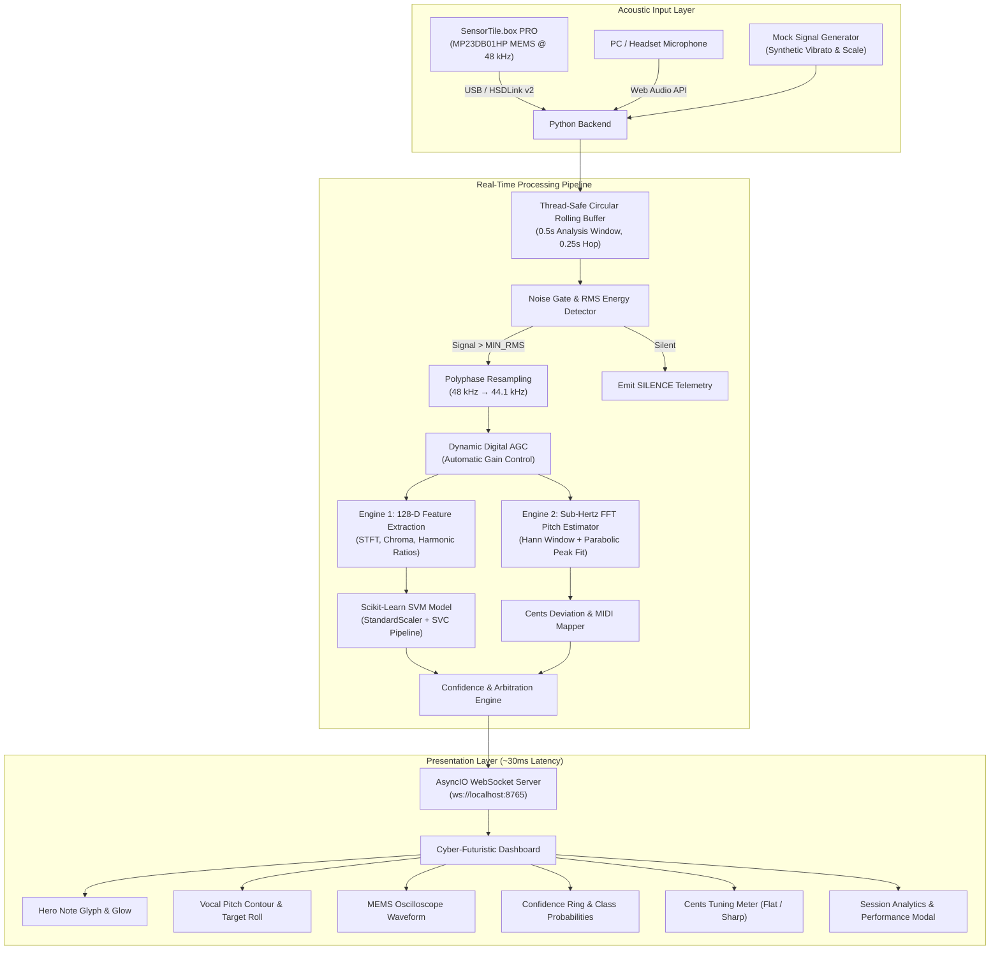

<div align="center">

# 🎵 NOTE PULSE
### Real-Time Edge AI Musical Note & Vocal Pitch Intelligence

[](https://python.org)
[](https://www.st.com/en/evaluation-tools/steval-mkboxpro.html)
[](https://scikit-learn.org)
[](https://websockets.readthedocs.io)
[](LICENSE)

<br/>

> **"A tiny MEMS microphone. A live acoustic signal. An AI ear."**

*A cyber-futuristic, dual-engine pitch and musical note monitoring system streaming live high-fidelity audio from the STMicroelectronics SensorTile.box PRO over USB, classifying musical notes with machine learning, tracking vocal pitch contours with sub-Hertz precision, and rendering telemetry at ~30 ms latency.*

<br/>

[Key Highlights](#-key-highlights) •
[Architecture](#-system-architecture) •
[Interactive Dashboard](#-cyber-futuristic-dashboard) •
[Hardware Specs](#-hardware--sensor-specs) •
[Quickstart](#-quickstart-guide) •
[Configuration](#-tunable-parameters)

---

</div>

<br/>

## ⚡ What Makes NotePulse Interesting?

Most musical tuners and pitch detectors rely solely on simplistic zero-crossing algorithms or rudimentary autocorrelation that easily stumble on complex vocal harmonics, background noise, or room reverb. On the other end of the spectrum, deep learning audio models are often too heavy to stream seamlessly with edge microcontrollers.

**NotePulse bridges physical edge acoustic sensing directly to a real-time dual-engine AI pipeline:**

1. **Dual-Engine Detection (Physics + Machine Learning)**:
   - **Engine 1 (128-D Feature SVM Classifier)**: Trained directly on real MEMS microphone acoustic recordings (`C4`, `C5`, `F5`) through STFT spectral envelopes, harmonic ratios, and chroma profiles, achieving **95.5% validation accuracy**.
   - **Engine 2 (Sub-Hertz Fundamental Frequency Tracker)**: Hann-windowed, zero-padded parabolic spectral peak interpolation capable of locking onto vocal fundamentals across **C3 to C6** with real-time **cents-deviation tuning** (±50 cents accuracy).
   - **Reconciliation Engine**: Dynamically reconciles ML class probabilities with physical acoustic fundamentals to eliminate octave jumping and false positives.

2. **Ultra-Low Latency Pipeline**:
   - Streams 48 kHz uncompressed int16 audio from the hardware MEMS microphone over USB via ST's **HSDLink v2 / PnPL** protocol.
   - Pushes into a rolling circular buffer, performs polyphase resampling (48 kHz → 44.1 kHz), and executes feature extraction & inference in under **35 ms**.

3. **Three Versatile Operational Modes**:
   - 🔌 **SensorTile USB Mode**: Streams directly from the STMicroelectronics SensorTile.box PRO board.
   - 🎙️ **PC Microphone Mode**: Capture directly from your computer or headset microphone with zero hardware needed!
   - 🧪 **Mock Simulation Mode**: Generates realistic musical sweeps with synthetic vocal vibrato for testing UI and telemetry pipelines offline.

4. **Complete Song & Vocal Performance Analytics**:
   - Sing, hum, or play an instrument, and hit the **"Complete Song & Summary"** button to review your session pitch accuracy, note distribution, in-tune percentage, and longest note hold duration.

---

## 🏛 System Architecture



---

## 🎛 Cyber-Futuristic Dashboard

The NotePulse dashboard is designed with a dark sci-fi aesthetic inspired by avionics displays and modular synthesizers:

- **Hero Note Display**: Large geometric note glyph with adaptive ambient backglow (emerald for in-tune, cyan for active, amber for tuning corrections).
- **Pitch Contour & Target Roll**: Real-time canvas rendering continuous pitch trajectories plotted alongside standard musical target lanes (C4, C5, F5, etc.).
- **Digital Oscilloscope**: Live audio wave visualizer showing instantaneous MEMS microphone voltage fluctuations with dynamic visual scaling.
- **AI Confidence Gauge & Probabilities**: Animated SVG circular confidence meter paired with real-time class probability breakdown bars.
- **Tuning Precision Meter**: Real-time cents calculation ($cents = 1200 \times \log_2(f / f_{target})$) indicating whether the performer is pitch-perfect, flat, or sharp.
- **Live Event Stream**: Interactive telemetry table recording timestamped note detections, frequencies, deviations, and latencies.

---

## 🔬 Hardware & Sensor Specs

| Specification | ST SensorTile.box PRO (`STEVAL-MKBOXPRO`) |
| :--- | :--- |
| **Microphone IC** | ST MP23DB01HP (High-Performance Digital MEMS) |
| **Sampling Frequency (ODR)** | 48,000 Hz |
| **Bit Depth & Format** | 16-bit signed PCM (int16), Mono |
| **Acoustic Overload Point** | 135 dBSPL |
| **Signal-to-Noise Ratio (SNR)** | 65 dB |
| **Protocol / Interface** | USB High-Speed Datalog v2 (HSDLink) / PnPL |
| **Timestamp Decoupling** | Automatic 8-byte sub-frame timestamp extraction |

---

## 📂 Project Structure

```
notepulse/
├── backend/
│   ├── realtime_sensor.py    # ST SensorTile HSDLink streaming & DataReader thread
│   ├── audio_processor.py    # Resampling, 128-D feature extraction & inference loop
│   ├── model_service.py      # Dual-engine reconciliation & SVM prediction service
│   ├── server.py             # Asyncio WebSocket server & client manager
│   └── __init__.py
├── frontend/
│   ├── index.html            # Main dashboard markup & modal views
│   ├── style.css             # Cyberpunk dark mode design system & animations
│   └── app.js                # WebSocket client, pitch canvas & analytics engine
├── models/
│   ├── note_classifier.joblib # Serialized scikit-learn SVM model (95.5% val acc)
│   └── train_note_classifier.py # 128-D feature extraction & model training script
├── shared/
│   ├── config.py             # Global tunable thresholds & server ports
│   ├── note_utils.py         # Sub-Hertz pitch detection & frequency-to-cents math
│   └── __init__.py
├── requirements.txt          # Python library dependencies
├── .gitignore                # Git ignore rules for caches and environments
└── README.md                 # Project documentation
```

---

## 🚀 Quickstart Guide

### 1. Clone the Repository
```bash
git clone https://github.com/Ummmahek/notepulse-stm.git
cd notepulse-stm
```

### 2. Set Up Python Environment
Create and activate a virtual environment:
```powershell
python -m venv .venv
.\.venv\Scripts\activate
```

Install the dependencies:
```powershell
pip install -r requirements.txt
```

---

### 3. Run the Backend

Choose whichever mode matches your current setup:

#### Option A: Mock Simulation (No Hardware Needed)
> Ideal for testing the dashboard, pitch contour canvas, and animations immediately.
```powershell
python backend/server.py --mock
```

#### Option B: Real ST SensorTile.box PRO Hardware
1. Connect the **SensorTile.box PRO** to your computer via USB.
2. Ensure the ST DATALOG GUI is **closed** (to prevent USB port conflicts).
3. Start the backend:
```powershell
python backend/server.py --real
```

*(Optional: Set the `ST_SDK_ROOT` environment variable if your ST DataLog SDK is in a custom folder)*:
```powershell
$env:ST_SDK_ROOT="C:\path\to\your\stdatalog-pysdk"
python backend/server.py --real
```

---

### 4. Launch the Dashboard

Simply open `frontend/index.html` in your favorite modern browser:

```powershell
# Using Python's built-in HTTP server:
python -m http.server 3000 --directory frontend
```
Navigate to **`http://localhost:3000`** and click **`▶ START MONITORING`**!

---

## ⚙️ Tunable Parameters

All core thresholds, audio sample rates, and analysis parameters can be customized in `shared/config.py`:

| Parameter | Default | Description |
| :--- | :--- | :--- |
| `CONFIDENCE_THRESHOLD` | `0.55` | Confidence cutoff below which unknown sounds are labeled as unclassified |
| `WINDOW_SECONDS` | `0.50` | Length of audio analysis slice (seconds) |
| `STEP_SECONDS` | `0.25` | Interval between consecutive AI predictions (hop size) |
| `MIN_RMS` | `0.00025` | Signal energy threshold below which frames are flagged as silence |
| `SENSOR_SAMPLE_RATE` | `48000` | Native sample rate delivered by SensorTile MEMS microphone (Hz) |
| `MODEL_SAMPLE_RATE` | `44100` | Sample rate expected by the ML feature extraction pipeline (Hz) |
| `SERVER_PORT` | `8765` | WebSocket listening port |

---

## 🧠 Machine Learning Details

- **Input Dimension**: 128 acoustic features per window.
- **Extracted Features**:
  - Short-Time Fourier Transform (STFT) spectral distribution across 64 bins.
  - Multi-order harmonic ratios ($f_0$, $2f_0$, $3f_0$, $4f_0$).
  - Spectral roll-off, spectral centroid, spectral flux, and RMS energy.
  - 12-dimensional chroma vector tracking pitch class energy.
- **Classifier**: Support Vector Machine (`SVC(kernel='rbf', probability=True)`) with prior `StandardScaler` normalization.
- **Classes**: `C4` (~261.6 Hz), `C5` (~523.3 Hz), `F5` (~698.5 Hz) specialized classification, coupled with continuous arbitrary-pitch chromatic tracking ($C_3$–$C_6$).

---

## 📜 License & Attribution

- Built with ❤️ for acoustic intelligence and edge AI exploration.
- Sensor interface utilizes the STMicroelectronics High Speed Datalog protocol (`stdatalog-pysdk`).
- Distributed under the [MIT License](LICENSE).
